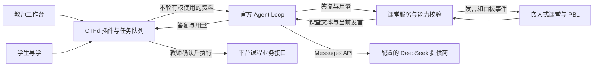

# 开发版智能体迁移与平台审查

审查基线为 `develop` 的 `e32fa59a`。本文记录平台代码的实际调用关系、这一版修复的缺陷，以及验收时需要分别验证的入口。运行实例的 commit、镜像和开关以部署记录为准。[变更与检查结果](https://github.com/Fisherder/AISecEdu/pull/7)

## 源码与运行边界

官方 `dsh-v0.2.2-rc.4` 固定在 `vendor/deepseek-harness`，Git 提交为 `3f321d32bfe382212a8ed8785c1d47a5a300aa23`。父仓库直接跟踪全部 21,071 个文件，普通克隆即包含 CLI、网页、插件、Python、原生代码、文档、测试、许可证和第三方声明。平台的 HTTP 接口、课堂显示和权限适配放在该目录之外。运行镜像通过锁文件安装同版本的官方 npm 包。上游将此版本列为开发者预览。[固定版本与许可证](https://github.com/deepseek-ai/deepseek-harness/tree/3f321d32bfe382212a8ed8785c1d47a5a300aa23)



一次内部 `POST /v1/turn` 对应一个独立的内存会话。上游负责 Agent、会话事件、模型调用和终态判定。平台负责账号、课程成员、作业审批和持久业务记录。模型只能返回文字或教学草案；课程变更要经过平台的权限与审批接口。容器没有宿主目录、Docker socket、数据库口令或宿主监听端口。运行组合没有注册命令执行、文件、网页搜索、远程插件或实验环境操作工具。开发分支可以检出上游完整源码，服务启动时仅加载本文列出的能力。

## 入口与实际行为

| 入口 | 已接入的行为 | 兼容和边界 |
| --- | --- | --- |
| 教师工作台的新 `agent.chat` | 问答、分析、计划和审批草案走上游。支持课程创建或更新、章节创建或更新、把已选材料加入章节 | 工作线程重查身份、课程和章节范围。审批及落库使用本项目的业务处理，回复可以引用已完成操作的回执。历史作业沿用冻结的请求与已登记的执行路径 |
| 学生 `/guide` | 将本人的学习问题、限定引用和相应的对话历史交给上游 | 入口仍由平台验证用户与引用范围，保留原有的离线状态和答复校验 |
| 普通课堂 `/api/chat` | 主持判断与角色发言由官方引擎产生。客户端沿用原有的发言、提示和白板事件 | 保留流式 HTTP 事件顺序；模型交付完整文本后开始下发对应文字，首段显示时延和以前逐 token 转发的模式有差异 |
| PBL `/api/pbl/chat` 的普通提问 | 课堂议题、当前对话与角色进入同一个受限服务 | 保留客户端 JSON 和现有的配额入口。图片证据需要独立的多模态契约 |
| 题内 Tutor、正式产物和历史回放 | 保留已有专用处理 | Tutor 包含桌面图像和私有答案过滤，产物任务有版本、评分或文件交付契约。文字服务不能用一段对话替代这些结果 |

具体应用端点以代码和本 PR 的集成测试为准。原版 CLI 的本地开发者工具没有直接挂到共享教学平台的 HTTP 接口。[官方安全模型](https://github.com/deepseek-ai/deepseek-harness/blob/3f321d32bfe382212a8ed8785c1d47a5a300aa23/SAFETY.zh.md)

## 平台审查与改进

| 范围 | 基线中的具体问题 | 本次处理与验收方式 |
| --- | --- | --- |
| 教师与学生入口 | Python 队列、同步导学、Node 课堂分别选择模型；一个入口成功无法证明其他入口也已迁移 | 在真实服务接口下验证模型、用量、停用、超时、并发会话和异常终态。在客户端用合成课堂逐一验证旧数据和页面响应 |
| 教师数据范围 | 教师工作台拼接课程事实时会构造最多 500 名学生的逐人记录，和班级统计一起进入模型上下文 | 改为查询班级汇总，在模型边界只投影必要课程事实和选定引用。对旧与新后端三种执行模式使用独有标记检查姓名、学号、人员 ID 和逐人成绩不会经这些结构字段进入请求。自由输入与教师主动选入的教材仍可能含个人信息 |
| 教师课程中心 | 在课程甲发出的材料、邀请码、学情请求可能在切换到乙后才返回，覆盖乙的页面；旧确认弹窗也可能向当前页面的课程写入 | 读取和确认动作绑定最初的课程与请求。学情随课程重新加载。在真实 Chromium 的 1440 px 和 390 px 视口按乱序返回，并验证切换时的确认不会触发变更 |
| 教学接口与目录 | 基线中教学 API 文件达 13,381 行，作业调度文件 4,834 行，学习智能模块 2,266 行。目录曾只在前 320 个字符的介绍中检索 | 将可独立验证的课程筛选、排序和分页抽到 `dojo_plugin/learning/course_catalog.py`。对完整描述匹配，列表保留 320 字预览。权限仍在 API 层，统计基于允许查看的课程 |
| 持久任务 | 重试时重新生成模型输入会破坏与已审批内容的对应，同一任务重复写入可能造成二次操作 | 复用冻结请求、范围检查和审批记录。普通模型回合不能直接写库。已有任务必须按原契约读取；升级验收应覆盖升级前创建、升级后重试及切换课程三种状态 |
| 备份与还原 | 转储或下载中途失败可能留下看似完成的备份，恢复失败也可能表现为成功 | 完成的转储通过同目录暂存文件发布。恢复使用配置数据库和单一事务，并把数据库错误传回调用者。使用故障注入覆盖本地及云备份命令，不改现有备份文件 |
| 发布与依赖 | 上游开发预览变化快，单靠包名或镜像标签无法重现功能。仓库内嵌的 Node 工作流不会自动在父仓库执行 | 在父仓库检查固定上游提交，构建无特权容器，用本地模型夹具运行官方适配器，单独运行 Python 和课堂测试。新版本同时更新完整源码目录、上游提交、npm 锁、集成测试及发布记录 |
| 容量和运行环境 | 共享开发实例使用业务数据副本，重型构建还受容量预约限制。代码通过或容器可启动不足以验证真实部署 | 构建使用隔离执行器。开发部署应记录源码和镜像标识，先以合成账号和课程验收，再检查版本端点及健康状态 |

仍需单独量测课程目录在大课程数下的数据库查询数和耗时。抽出筛选模块修正了检索行为，未把分页下推至 SQL。题内多模态、评分和历史任务若需更换运行引擎，应在同一份合成输入上对照两版业务结果，并验证旧作业可以恢复。课堂首段文字显示时间应以同一模型、同一教材实际测量。

## 配置、验收与回退

主节点使用受限运行配置中的 `HARNESS_DEEPSEEK_API_KEY`、`HARNESS_DEEPSEEK_BASE_URL` 与 `HARNESS_DEEPSEEK_MODEL`。模型地址默认 `https://api.deepseek.com/anthropic`，须支持 Anthropic Messages 协议。`dojo-init` 为应用到内部服务的调用单独生成 `HARNESS_SERVICE_SECRET`。供应商密钥只交给模型服务。专用配置的值通过平台受保护配置提供，工作树、浏览器和 CI 用合成值。旧产品模型凭据和 PR 审核凭据有各自的用途。

`DOJO_AI_ENABLED=auto` 时，专用凭据使主节点启用 Harness profile；显式 `false` 时关闭。Python 和课堂服务可读内部地址、服务鉴权和配置状态。客户端不能指定模型供应商、地址和密钥来覆盖普通课堂的配置。`GET /health` 只验证进程可达；一轮合成请求的有效模型、内容和 token 用量可验证调用链。

在个人开发副本运行以下验证。平台快速检查和课堂服务使用 Node 22，独立 Harness 服务使用 Node 24.9 或更新的 24.x。Python 测试依赖见 `ops/team/requirements.txt`，课堂依赖使用项目固定的 pnpm 10.28.0。

```sh
git rev-parse HEAD:vendor/deepseek-harness
# 官方目录树应为 6778b1f1e75fde6d62f69d345792bf08e32178d4
git ls-tree -r HEAD:vendor/deepseek-harness | wc -l
make dev-check
python -m pytest -q test/test_upstream_teaching_turn_unit.py test/test_agent_harness_unit.py test/test_course_catalog_unit.py
npm ci --prefix services/deepseek-harness --ignore-scripts --omit=dev
npm test --prefix services/deepseek-harness
python test/harness_client_contract.py
```

跨进程测试从真实的 Python 教学客户端发请求，经过 Node HTTP 服务、官方循环与官方模型适配器，到本机的 Messages 夹具，再验证原路返回的模型及用量。不会使用外部模型余额。课堂回归在 `services/agent-runtime` 中安装锁定依赖后执行 `pnpm exec tsc --noEmit` 和父仓库工作流列出的 Vitest 套件。浏览器回归是 `CHROME_BIN=/path/to/chrome node test/browser/teacher-course-navigation.mjs`。正式构建和共享联调见[维护者手册](operations.md)。

发布前记录现有 Web、Worker 和课堂镜像，并确认上次数据库备份可读。部署时保持 Web 和 Worker 使用相同版本，以合成教师验证只读咨询与一次审批操作，以合成学生验证导学、课堂问答、跨班访问和关闭 AI 时的提示。需紧急停止外送时，关闭开发实例的 AI 开关并重新加载受影响服务。需要恢复上一版行为时，恢复这一组镜像及其配置；先处理升级后尚未完成的作业，避免由旧 worker 重复领取。恢复服务版本无需还原业务数据库。数据库灾备演练应在独立库进行。
