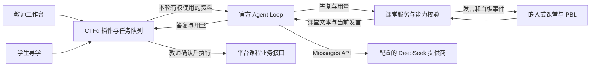

# 开发版智能体迁移与平台审查

审查基线为 `develop` 的 `e32fa59a`。本文记录平台代码的实际调用关系、这一版修复的缺陷，以及验收时需要分别验证的入口。运行实例的 commit、镜像和开关以部署记录为准。[变更与检查结果](https://github.com/Fisherder/AISecEdu/pull/7)

## 源码与运行边界

官方 `dsh-v0.2.2-rc.4` 固定在 `vendor/deepseek-harness`，Git 提交为 `3f321d32bfe382212a8ed8785c1d47a5a300aa23`。父仓库直接跟踪全部 21,071 个文件，普通克隆即包含 CLI、网页、插件、Python、原生代码、文档、测试、许可证和第三方声明。平台的 HTTP 接口、课堂显示和权限适配放在该目录之外。运行镜像将整套源码放在 `/opt/deepseek-harness`，同时安装固定版本的官方发行包 `@deepseek-ai/dsh`，可执行文件位于 `/usr/local/bin/dsh`。教学 HTTP 接口使用同一套官方依赖，按教学用途加载插件。CI 同时核对 GitHub 官方提交的树哈希，并从镜像取出整套源码同工作树逐文件比较。上游将此版本列为开发者预览。[固定版本与许可证](https://github.com/deepseek-ai/deepseek-harness/tree/3f321d32bfe382212a8ed8785c1d47a5a300aa23)



一次内部 `POST /v1/turn` 对应一个独立的内存会话。上游负责 Agent、会话事件、模型调用和终态判定。平台负责账号、课程成员、作业审批和持久业务记录。模型只能返回文字或教学草案；课程变更要经过平台的权限与审批接口。容器没有宿主目录、Docker socket、数据库口令或宿主监听端口。运行组合没有注册命令执行、文件、网页搜索、远程插件或实验环境操作工具。开发分支可以检出上游完整源码，服务启动时仅加载本文列出的能力。

2026-11-18 的验收分别检查了三处。GitHub PR 普通检出与服务器个人验收副本 `/home/ubuntu/aisecedu-review/pr7/vendor/deepseek-harness` 均有完整的 21,071 个文件和相同的 Git 树。CI 完成教学容器内逐文件比对。官方 npm 发行版的原生 CLI 在独立目录启动，`dsh --version` 返回 `0.2.2-rc.4`。`28081/_aisecedu/version.json` 在本次核对时仍为 `e32fa59a`，其运行配置关闭了课堂服务、模型和后台任务；部署进度应查版本端点。

## 入口与实际行为

| 入口 | 已接入的行为 | 兼容和边界 |
| --- | --- | --- |
| 教师工作台的新 `agent.chat` | 问答、分析、计划和审批草案走上游。支持课程创建或更新、章节创建或更新、把已选材料加入章节 | 工作线程重查身份、课程和章节范围。审批及落库使用本项目的业务处理，回复可以引用已完成操作的回执。历史作业沿用冻结的请求与已登记的执行路径 |
| 教师教案与讲义 | 教师明确请求 DOCX 或 Markdown 时，使用受限教学文档格式，在平台生成可以下载的真实文件 | 生成前固定材料引用，保存前复核权限。下载处理器校验归属，模型不会直接写文件 |
| 学生 `/guide` | 将本人的学习问题、限定引用和相应的对话历史交给上游 | 入口仍由平台验证用户与引用范围，保留原有的离线状态和答复校验 |
| 普通课堂 `/api/chat` | 主持判断与角色发言由官方引擎产生。客户端沿用原有的发言、提示和白板事件 | 保留流式 HTTP 事件顺序；模型交付完整文本后开始下发对应文字，首段显示时延和以前逐 token 转发的模式有差异 |
| Pi 课堂 `/api/chat/pi` | 发言人选择、阅读当前公开课件、白板动作、邀请学生发言和结束课堂由 Harness 回合及课堂服务协作完成 | 保留设置开关与 SSE。模型收到公开课件和本人已提交的作答状态，标准答案和批改备注留在平台 |
| 学生咨询 `/api/student/agent`、复习 `/api/student/review` | 个人计划、普通咨询和形成性反馈使用官方模型 | 保留学习者身份、计划存储和真实用量。离线时明确返回相应状态 |
| 个人学习包 | 学生在已登录的 `/guide` 明确请求后，可打开自己的概念讲义与自检反馈。普通 PBL 的文字评语沿用原有回复格式 | 创建时验证请求所属会话和学习者范围；学习包是私人草稿。教师查看已提交成果要走原有审阅权限 |
| 题内辅导 `/learning/tutor` | 本人问题、公开目标与提示、经平台核验的学习观察进入上游 | 保留尝试记录与本地防泄题处理。模型无法访问学生桌面、终端或私有解法。实验中的操作指导仍需要教师参与 |
| PBL 答疑与 v2 判评 | 普通文字提问及阶段、任务和最终判评走上游。图片判评使用本次选中、绑定最新提交的教学图片 | 来历不明的远程 URL 不进入取图流程。只有旧 URL 且没有文字说明的记录需要重新选择附件 |
| 课堂辩论 `/api/integration/debate/respond` | 回合与反思使用实际模型，保留论据校验和检查点 | 重试核验请求身份与模型，凭实际模型回执登记用量 |
| 正式原生课件 | 当前授课教师的 `native-v2` 课件制作通过 Harness，保留原有的产物、渲染和逐页恢复检查点 | 验收覆盖重复请求恢复已完成页面；机器执行类作业和其他产物有独立执行契约 |

具体应用端点以代码和本 PR 的集成测试为准。原版 CLI 的本地开发者工具没有直接挂到共享教学平台的 HTTP 接口。[官方安全模型](https://github.com/deepseek-ai/deepseek-harness/blob/3f321d32bfe382212a8ed8785c1d47a5a300aa23/SAFETY.zh.md)

## 平台审查与改进

| 范围 | 基线中的具体问题 | 本次处理与验收方式 |
| --- | --- | --- |
| 教师与学生入口 | Python 队列、同步导学、Node 课堂分别选择模型；一个入口成功无法证明其他入口也已迁移 | 在真实服务接口下验证模型、用量、停用、超时、并发会话和异常终态。在客户端用合成课堂逐一验证旧数据和页面响应 |
| 教师数据范围 | 教师工作台拼接课程事实时会构造最多 500 名学生的逐人记录，和班级统计一起进入模型上下文 | 改为查询班级汇总，在模型边界只投影必要课程事实和选定引用。对旧与新后端三种执行模式使用独有标记检查姓名、学号、人员 ID 和逐人成绩不会经这些结构字段进入请求。自由输入与教师主动选入的教材仍可能含个人信息 |
| 教师课程中心 | 在课程甲发出的材料、邀请码、学情请求可能在切换到乙后才返回，覆盖乙的页面；旧确认弹窗也可能向当前页面的课程写入 | 读取和确认动作绑定最初的课程与请求。学情随课程重新加载。在真实 Chromium 的 1440 px 和 390 px 视口按乱序返回，并验证切换时的确认不会触发变更 |
| 教学接口与目录 | 基线中教学 API 文件达 13,381 行，作业调度文件 4,834 行，学习智能模块 2,266 行。目录曾只在前 320 个字符的介绍中检索 | 将可独立验证的课程筛选、排序和分页抽到 `dojo_plugin/learning/course_catalog.py`。对完整描述匹配，列表保留 320 字预览。权限仍在 API 层，统计基于允许查看的课程 |
| 模型审计 | 旧的 provider 审计保存可逆编码的请求、响应和推理副本 | 新记录保留调用顺序、字节数、摘要、状态与用量。历史事件可读，业务重试使用独立的冻结输入；不会自动清理早期审计和备份 |
| 持久任务 | 重试时重新生成模型输入会破坏与已审批内容的对应，同一任务重复写入可能造成二次操作 | 复用冻结请求、范围检查和审批记录。普通模型回合不能直接写库。已有任务必须按原契约读取；升级验收应覆盖升级前创建、升级后重试及切换课程三种状态 |
| 备份与还原 | 转储或下载中途失败可能留下看似完成的备份，恢复失败也可能表现为成功 | 完成的转储通过同目录暂存文件发布。恢复使用配置数据库和单一事务，并把数据库错误传回调用者。使用故障注入覆盖本地及云备份命令，不改现有备份文件 |
| 发布与依赖 | 上游开发预览变化快，单靠包名或镜像标签无法重现功能。仓库内嵌的 Node 工作流不会自动在父仓库执行 | 在父仓库检查固定上游提交，构建无特权容器，用本地模型夹具运行官方适配器，单独运行 Python 和课堂测试。新版本同时更新完整源码目录、上游提交、npm 锁、集成测试及发布记录 |
| 容量和运行环境 | 共享开发实例使用业务数据副本，重型构建还受容量预约限制。代码通过或容器可启动不足以验证真实部署 | 构建使用隔离执行器。开发部署应记录源码和镜像标识，先以合成账号和课程验收，再检查版本端点及健康状态 |

仍需单独量测课程目录在大课程数下的数据库查询数和耗时。抽出筛选模块修正了检索行为，未把分页下推至 SQL。实验桌面、专用评分和历史任务若需更换运行引擎，应在同一份合成输入上对照两版业务结果，并验证旧作业可以恢复。课堂首段文字显示时间应以同一模型、同一教材实际测量。

## 配置、验收与回退

主节点使用受限运行配置中的 `HARNESS_DEEPSEEK_API_KEY`、`HARNESS_DEEPSEEK_BASE_URL` 与 `HARNESS_DEEPSEEK_MODEL`。模型地址默认 `https://api.deepseek.com/anthropic`，正式调用名默认 `deepseek-flash`。文本和图片均通过官方 Messages 协议提交。共享服务对外仅允许请求配置的 Messages 地址。教学图片在每个请求私有的临时目录中经过原版附件插件验证、归一化并以行内数据发送，请求结束后清理。`dojo-init` 为应用到内部服务的调用单独生成 `HARNESS_SERVICE_SECRET`。供应商密钥只交给模型服务。专用配置的值通过平台受保护配置提供，工作树和 CI 仅使用合成凭据。2026-11-18 的真实接口验收使用独立进程、四字课程回执和程序绘制的纯红色卡，两项均通过。旧产品模型凭据和 PR 审核凭据有各自的用途。

`DOJO_AI_ENABLED=auto` 时，专用凭据使主节点启用 Harness profile；显式 `false` 时关闭。Python 和课堂服务可读内部地址、服务鉴权和配置状态。客户端不能指定模型供应商、地址和密钥来覆盖普通课堂的配置。`GET /health` 只验证进程可达；一轮合成请求的有效模型、内容和 token 用量可验证调用链。

在个人开发副本运行以下验证。平台快速检查和课堂服务使用 Node 22，独立 Harness 服务使用 Node 24.9 或更新的 24.x。Python 测试依赖见 `ops/team/requirements.txt`，课堂依赖使用项目固定的 pnpm 10.28.0。

```sh
git rev-parse HEAD:vendor/deepseek-harness
# 官方目录树应为 6778b1f1e75fde6d62f69d345792bf08e32178d4
git ls-tree -r HEAD:vendor/deepseek-harness | wc -l
make dev-check
python -m pytest -q test/test_upstream_teaching_turn_unit.py test/test_agent_harness_unit.py test/test_tutor_teaching_turn_unit.py test/test_course_catalog_unit.py
npm ci --prefix services/deepseek-harness --ignore-scripts --omit=dev
npm test --prefix services/deepseek-harness
python test/harness_client_contract.py
```

跨进程测试从真实的 Python 教学客户端发请求，经过 Node HTTP 服务、官方循环与官方模型适配器，到本机的 Messages 夹具，再验证原路返回的模型及用量。不会使用外部模型余额。课堂回归在 `services/agent-runtime` 中安装锁定依赖后执行 `python3 ../../ops/team/check_agent_runtime_types.py` 和父仓库工作流列出的 Vitest 套件。浏览器回归是 `CHROME_BIN=/path/to/chrome node test/browser/teacher-course-navigation.mjs`。正式构建和共享联调见[维护者手册](operations.md)。

发布前记录现有 Web、Worker 和课堂镜像，并确认上次数据库备份可读。部署时保持 Web 和 Worker 使用相同版本，以合成教师验证只读咨询与一次审批操作，以合成学生验证导学、课堂问答、跨班访问和关闭 AI 时的提示。需紧急停止外送时，关闭开发实例的 AI 开关并重新加载受影响服务。需要恢复上一版行为时，恢复这一组镜像及其配置；先处理升级后尚未完成的作业，避免由旧 worker 重复领取。恢复服务版本无需还原业务数据库。数据库灾备演练应在独立库进行。

课堂普通短答 `/api/quiz-grade` 使用 Harness 回合和实际计费用量，判评未完成时保留原答卷并允许重试，成绩仅在全部题目评分有效后写入。

## TypeScript 历史测试诊断

PR #7 的 `classroom-contracts` 首次完整运行 TypeScript 时，应用代码通过，11 个旧测试报告 40 条诊断。本次修复了模型结构化输出夹具和教师意图断言的两条诊断。余下 38 条记录在[精确诊断基线](../../ops/team/agent-runtime-typescript-baseline.json)，涉及旧场景与流程测试、辩论代理测试及生成修复路由测试。其中三条来自 `generated-valve-review-case.json`、`generated-stux-review-case.json` 和 `generated-stux-pointer-review-case.json` 缺失。没有将本地不可复现的生成内容替代为历史夹具。既有的辩论请求体限制断言及生成路由遗漏选项断言也仍有独立的运行时失败。

此门检仍编译应用和全部测试，并在 CI 打印完整 TypeScript 输出。只有基线中精确记录的旧测试位置、完整诊断和出现次数可以通过。应用代码、PR 测试或其他位置的任何新诊断均使任务失败。修复历史原因后删除对应基线记录。保留现有分支保护与代码所有者审批。
