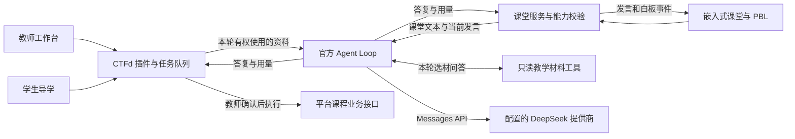

# 开发版智能体迁移与平台审查

平台审查从 `develop` 的 `e32fa59a` 开始，集成分支已同步到 `develop` 的 `8a91fa66`。PR #11 接入正式评审事件，PR #12 修复分段报告的格式校验。完整官方 Harness 与第一批教学入口已通过 PR #9 提交审查，普通课堂、课件和 Tutor 的后续改动在 `feat/codex/ordinary-studio-quiz` 联调。运行版本以开发实例的版本端点为准。[当前集成 PR](https://github.com/Fisherder/AISecEdu/pull/9) · [普通课堂分支](https://github.com/Fisherder/AISecEdu/tree/feat/codex/ordinary-studio-quiz) · [早期审查记录](https://github.com/Fisherder/AISecEdu/pull/7)

## 源码与运行边界

官方 `dsh-v0.2.2-rc.4` 固定在 `vendor/deepseek-harness`，Git 提交为 `3f321d32bfe382212a8ed8785c1d47a5a300aa23`。父仓库直接跟踪全部 21,071 个文件，普通克隆即包含 CLI、网页、插件、Python、原生代码、文档、测试、许可证和第三方声明。平台的 HTTP 接口、课堂显示和权限适配放在该目录之外。运行镜像将整套源码放在 `/opt/deepseek-harness`，同时安装固定版本的官方发行包 `@deepseek-ai/dsh`，可执行文件位于 `/usr/local/bin/dsh`。教学 HTTP 接口使用同一套官方依赖，按教学用途加载插件。CI 同时核对 GitHub 官方提交的树哈希，并从镜像取出整套源码同工作树逐文件比较。上游将此版本列为开发者预览。[固定版本与许可证](https://github.com/deepseek-ai/deepseek-harness/tree/3f321d32bfe382212a8ed8785c1d47a5a300aa23)



一次内部 `POST /v1/turn` 对应一个独立的内存会话。上游负责 Agent、会话事件、模型调用和终态判定。平台负责账号、课程成员、作业审批和持久业务记录。模型只能返回文字或教学草案；课程变更要经过平台的权限与审批接口。容器没有宿主目录、Docker socket、数据库口令或宿主监听端口。运行组合没有注册命令执行、文件、网页搜索、远程插件或实验环境操作工具。开发分支可以检出上游完整源码，服务启动时仅加载本文列出的能力。

### 教师选定资料后使用「仅问答」

教师在工作台选择 1 到 4 份普通课程资料，输入问题后点击「仅问答」。本轮只读取明确选择的材料。平台在入队、发送和保存答案时核对教师权限、课程、资料版本及文本摘要。已选材料更新、权限撤回或课程未开放时，界面提示教师重新选择。普通发送和历史任务保留原有流程。

`POST /v1/teaching-material-turn` 为本轮建立独立 DSH 会话。模型先收到当前问题和可读序号，再通过官方工具执行器调用 `read_teaching_material`。每次调用只能读取一个序号，工具结果随后进入同一个会话。回执记录实际读取顺序和各次模型调用的用量，平台将序号写入教师回答的元数据。此入口只提供选材问答；课程变更走教师审批。

### 运行版本与验收记录

| 验收对象 | 版本与结果 |
| --- | --- |
| 开发主机上的候选代码，2026-11-22 | 以 PR #9 的 `ed46b0aa` 只读挂入教学适配器和测试，复用依赖清单及锁文件均相同的 Linux 镜像。在断外网的容器里重新计算整棵上游源码树，21,071 个文件的树哈希为 `6778b1f1e75fde6d62f69d345792bf08e32178d4`。CLI 报告 `0.2.2-rc.4`，合成 Messages 服务下两项测试通过 |
| 官方模型接口，2026-11-22 | 同一候选适配器向官方 Messages 端点请求 `deepseek-flash`。文字回合回答了合成算术题，图片回合识别了程序生成的蓝色色卡，回执用量分别为 71 和 328 个 token。两次验收均使用合成输入 |
| 开发主机复验，2026-11-22 | PR #9 提交 `5ba07075` 在断外网的 Linux 容器中通过两项教学适配测试。Node 为 24.22.3，官方 CLI、源码树及文件数与上表一致。后续提交 `8e373800` 的 `services/deepseek-harness` 和 `vendor/deepseek-harness` 两个目录与这次验收逐字节相同 |
| 课件配色，2026-11-22 | 在 `930e0b5e` 以三页合成课件请求蓝绿色主题。官方 Messages 接口一次调用返回六个颜色值及 2,146 个 token 的用量。Chromium 逐页渲染图表、配图及手工排版比较页，Python 保存前校验通过。另改动图表数值、移动标题或移除页面回执 ID，三份对照结果均被拒绝 |
| 本机真实 Chromium，2026-11-22 | 在 `d3ba1463` 的普通课件修订代码上，合成比较页 `plant-1` 通过文字修订和整套重排两条检查路径。浏览器返回一帧，服务端核对原始页面的 SHA-256 后绑定页面 ID。Python 保存前校验接受两个回执，也拒绝缺失及篡改页面 ID 的对照样本。另用合成分数图表核实，单独改变一个数值会改变实际渲染截图 |
| 原生资料工具，2026-11-23 | 在 `ce1773a3` 以两份合成植物观察记录调用官方 `deepseek-flash`。首轮请求只含问题、序号和工具说明。模型选择序号 2，第二次请求只携带该工具读回的摘录。回答正确给出 23 片叶子；两次调用合计输入 933、输出 57 个 token |
| 单页讲稿，2026-11-23 | 在 `1f4cb522` 用合成植物课件请求重写一页讲稿。一次官方 `deepseek-flash` 调用收到该页标题、结论、要点和教师本轮要求，返回 311 字，输入 162、输出 492 个 token。发送前检查确认原讲稿和其他页均未进入请求；在本地测试课件中验证了写回结果。 |
| 三个候选镜像，2026-11-23 | 在同一提交 `cfda078f` 构建 Linux amd64 的 Harness、课堂服务和 Chromium 检查器。下载后复核两个归档的 SHA-256、三个镜像的身份及源码版本。Harness 镜像内全部 21,071 个文件与固定的官方检出一致，含按上游规则检出为 CRLF 的三个 Windows 脚本。以开发主机实际 Compose 配置预演两种教学网络，两者均保留现有四个服务，预期共七个服务，无新增宿主端口。该次预演只渲染配置。[镜像构建](https://github.com/Fisherder/AISecEdu/actions/runs/45044813233) · [官方引擎验收](https://github.com/Fisherder/AISecEdu/actions/runs/45044813212) |
| 三服务联调，2026-11-23 | 在维护者本机隔离运行 `cfda078f` 的三个 Linux amd64 镜像。课堂对匿名调色请求返回 401，获授权的请求经过官方 DSH 和合成 Messages，返回同一页的新配色；Chromium 确认分数图表、标题和要点可见。模型接口收到一次调色请求，合成用量为输入 10、输出 5。整套三服务联调在新的 Compose 项目再次通过。 |
| 共享开发实例，2026-11-23 | 北京时间 00:10，服务器 `28081/_aisecedu/version.json` 与成员源码镜像均核实为 `85d745f5`。切换到该提交前逐一比对 726 个插件、主题与技能文件，备份开发库并验证备份目录。两个合成身份正常登录；教师访问教师页返回 200，学生访问同一页返回 403，两者均可进入学习页。验收后清理了测试课程和身份。课堂服务、外部 AI 与后台 Worker 仍待后续发布 |
| 共享开发实例更新，2026-11-23 | 北京时间 01:09，`28081` 与成员只读镜像均核实为受保护的 `8a91fa66`。单节点与多节点 CI 通过。开发库备份经校验，沿用原数据库和 Redis 容器，726 个文件只读挂载。用合成身份实测，教师和学生登录、访问学习页均返回 200；教师页分别返回 200 和 403。任务 `73d3149e57b5427489e442667bf247a0` 已完成，外部模型保持关闭。[完整 CI](https://github.com/Fisherder/AISecEdu/actions/runs/45043425961) |
| 原版 Web，2026-11-18 | 在隔离容器中验证匿名访问被拒绝，经启动链接换取登录 cookie 后，原版首页及 JavaScript 可正常加载 |
| 共享开发实例更新，2026-11-23 | 版本端点和成员只读镜像均为 `0ae28be6`。对比 726 个挂载文件后，保留了原 Web、数据库和缓存容器，更新了入口代理。登录页返回 200，访客打开教师页被重定向。DSH 候选在开发主机的隔离容器另行验收。 |

内部回执的 `model` 是官方 Agent Loop 向服务商发送的模型 ID。应用用它核对请求是否使用配置的模型，并按该 ID 归集服务商报告的 token 用量。当前官方适配器未在回执中保留服务商响应里的模型 ID，因此该字段无法证明服务商在后台选用了哪个模型，也无法核对别名的实际映射。

## 入口与实际行为

| 入口 | 已接入的行为 | 兼容和边界 |
| --- | --- | --- |
| 教师工作台的新 `agent.chat` | 问答、分析、计划和审批草案走上游。支持课程创建或更新、章节创建或更新、把已选材料加入章节 | 工作线程重查身份、课程和章节范围。审批及落库使用本项目的业务处理，回复可以引用已完成操作的回执。历史作业沿用冻结的请求与已登记的执行路径 |
| 教师教案与讲义 | 教师明确请求 DOCX 或 Markdown 时，使用受限教学文档格式，在平台生成可以下载的真实文件 | 生成前固定材料引用，保存前复核权限。下载处理器校验归属，模型不会直接写文件 |
| 教师用已发布课件准备课堂 | 教师在当前课程与章节指定课件，DSH 返回提案。确认后平台转换该版本的静态课件，创建一个待上课会话 | 模型收到代表本轮选择的临时代号。真实标题、课件 ID 和正文留在平台。平台保存批准记录、版本和内容摘要，同一提案重试返回原会话 |
| 学生 `/guide` | 将本人的学习问题、限定引用和相应的对话历史交给上游 | 入口仍由平台验证用户与引用范围，保留原有的离线状态和答复校验 |
| 普通课堂 `/api/chat` | 主持判断与角色发言由官方引擎产生。客户端沿用原有的发言、提示和白板事件 | 保留流式 HTTP 事件顺序；模型交付完整文本后开始下发对应文字，首段显示时延和以前逐 token 转发的模式有差异 |
| Pi 课堂 `/api/chat/pi` | 发言人选择、阅读当前公开课件、白板动作、邀请学生发言和结束课堂由 Harness 回合及课堂服务协作完成 | 保留设置开关与 SSE。模型收到公开课件和本人已提交的作答状态，标准答案和批改备注留在平台 |
| 独立课堂服务的 `/api/student/agent` 和 `/api/student/review` | 两个处理器已接入 Harness，保留学习者身份、计划存储和用量 | 集成部署的浏览器中间件没有开放这两个端点。平台学生的日常导学从 `/guide` 进入 |
| 个人学习包 | 学生在已登录的 `/guide` 可单独请求概念讲义、概念自检，也可请求同时包含两者的学习包。生成与保存均按本次所选内容执行。普通 PBL 的文字评语沿用原有回复格式 | 创建时验证请求所属会话和学习者范围；学习包是私人草稿。教师查看已提交成果要走原有审阅权限 |
| 题内辅导 `/learning/tutor` | 本人问题、公开目标与提示、经平台核验的学习观察进入上游。符合条件的课堂插图可以在同一问答侧栏按轮选择 | 保留尝试记录与本地防泄题处理。插图由服务端从已核验版本中读取，学习者逐次确认后才发送给模型。实验中的操作指导仍需要教师参与 |
| PBL 答疑与 v2 判评 | 普通文字提问及阶段、任务和最终判评走上游。普通教学课程内，用户可以为本轮判评重新选择教学图片并明确同意发送 | 提交前按当前会话复核身份、课程权限、额度及普通教学开关。本地保存的旧附件可继续查看；需要图片判评时重新选择上传，也可以只提交文字 |
| 普通 PBL v2 任务开场与导师 | `/open-task` 和 `/instructor` 走官方引擎，保留 SSE、持久化、观察记录和难度调整。普通短答评分采用官方引擎的实际回执 | 调整难度须引用本轮学生原话。短答无法取得有效评分时保持待评，可用原答卷重试 |
| 课堂辩论 `/api/integration/debate/respond` | 回合与反思请求配置的模型，保留论据校验和检查点 | 重试核验请求身份与模型，按回执中的请求模型登记用量 |
| 平台作业的简答与辩论评分 | 可使用本地初评或独立校内评分服务。旧安装留空时沿用既有评分配置。选答题留空直接记零分，数字 `0` 和布尔值 `false` 均保留为已作答。 | 模型评分缺失或无效时，按题在本地初评并标记教师复核。初评分计入当前总分。 |
| 正式原生课件 | 授课教师或平台管理员名下、属于当前课程的 `native-v2` 课件制作通过 Harness，保留原有的产物、渲染和逐页恢复检查点 | 验收覆盖重复请求恢复已完成页面；机器执行类作业和其他产物有独立执行契约 |
| 交互预览中的课件编辑器 | 普通教学课程的教师可在「Agent」面板按当前页、整套课件或选中对象请求调整。DSH 逐页返回可采用的改动 | 只提交本轮要求和所选范围内可编辑的文字及排版字段。课程材料、图片、讲者备注、历史指令和其他页面的内容留在平台 |

授课教师通过当前课程的 `DojoAdmins` 关系取得权限。平台管理员沿用教师工作台的全局管理权限。两类身份请求教材摘要、课件候选、单页文字修订或正式原生课件时，工作线程都会复查资源所有者和课程。前三项另查普通教学课程清单，教材摘要还会核对已就绪的材料版本。验收普通教师权限时，应使用有授课关系的非平台管理员账号。

平台作业按教师设置的时间公布参考答案和自动详评。公布前，学生可看本人作答、各题得分和待复核状态。教师单独填写的总评可提前显示，之后仅调整总分会保留这条总评。旧记录若无法确认评语由谁填写，则随参考答案一起公布。学生保存重答草稿时，界面隐藏上一轮详评。教师仍可在成绩册查看完整评分记录。

作业页的离线草稿按登录账号和作业分别保存。学生换账号后要重新打开作业页才能保存或交卷。同一账号仍可在多个标签页收到更新提示。旧版只存在浏览器、没有账号标记的草稿不会自动载入，已同步到平台的作答可从作业页继续编辑。含待复核题目的总分在页面标为初评分，教师改分后则显示教师给出的总分。

对普通教学课程，管理员可在开发实例的受保护配置中填写 `HARNESS_ORDINARY_TEACHING_COURSE_IDS`，值为逗号分隔的课程数字 ID，初始为空。授权教师的已索引教材摘要、教案和课件候选，以及原生静态课件的文字润色和版式修订由官方引擎处理。队列在生成前核实课程和材料归属，保留产物格式和原有保存检查。专用生成器和其他类型的修订仍有独立路径。

教师在课件产物页可以输入「请仅润色第2、4页的文字：让植物观察结论更适合初学者」。也可以写「第2页和第4页」。每张选中页分别提交可编辑的文字和需保留的字面量，平台在本地验证改动、检查渲染并保存一个新版本。页码重复、越界或选中不支持的页面时，任务返回错误。任何一张未通过验收，原版本继续生效。已入队的新任务会保留指定引擎，重试时复核课程与课件权限。

### 重写或缩短一页讲稿

在已启用普通教学的课程中，打开本人已发布的原生静态课件，在「局部修改」输入「请重写第2页的讲稿」。默认情况下，官方 DSH 只收到这页的标题、结论、要点和本轮要求。页面正文与讲稿分开保存，因此这次修改只会生成一版新的讲者备注。

若要保留原稿的教学事实，可输入「请缩短第2页的讲稿」，勾选「将指定页的原讲稿用于本次润色」后提交。勾选代表同意把这一版的该页原稿发送给课程配置的外部模型。改变要求、切换课件版本或再次提交时，需要重新勾选。服务器从已发布版本取稿，在发送前和写回时复核教师权限和版本。模型未按要求缩短，或执行期间课件已经更新，教师仍可打开先前的版本。

### 在课件产物页修订整套课件

在已启用普通教学的课程里，打开自己保存的原生静态课件。输入「请把整套课件的文字改得更清楚」时，Harness 先选择需要修改的现有页面，再逐页提交文字改动。平台保留页面标识、手工位置、图表数值和讲者备注。模型只收到教师本轮要求和面向学生的课件内容。

输入「请把这份植物生长课件从5页扩成8页」会生成一套新的静态图表或对比表页面。已有图片、手工移动的对象、明确要求保留原稿时，请在编辑器里增删页面。「不要扩展到8页，只改标题」会保留原页数。

要统一已有静态课件的颜色，可输入「请将整个课件换成蓝绿色主题」。普通图表、对比表和内嵌教学图片页支持这项修订。Harness 只接收教师这句要求和现有主题的六种颜色，平台在本地套用新色值。每页通过对比度和真实浏览器检查后，才保存新版本。讲者备注、图片字节、图表数据和手工移动的位置保留。如只需修改指定页，可输入「请将第3、1页换成蓝绿色主题」。工作台按显示页码找到第 1、3 页，并分别核对渲染结果；其余页面与课件的全局主题保留原样。需要同时调整字体或位置时，使用编辑器的排版功能。本机用含图表、内嵌插图和手工定位对比表的三页合成课件验收。真实 Chromium 给出三份回执，Python 可保存这一组颜色变更；改动图表数据、手工位置或删除一页回执时均拒绝保存。

该入口使用内部路径 `/api/integration/jobs/ordinary-deck-revision`。任务绑定教师提交时的课件版本、内容摘要和模型。保存前再次检查教师权限、版本、模型用量和浏览器逐页回执。检查失败时，教师可继续打开原版本。升级 Worker 前须先部署含该路径的课堂服务和浏览器检查器；队列中已有的历史任务沿用入队时记录的执行路径。

### 按教师看到的页码修改课件版式

在工作台打开原生静态课件，在「局部修改」输入「请调整第1、2页的版式：将比较区居中，左右各留 84 像素」。要统一整份课件，可以输入「请调整整份课件的版式：将标题右对齐」。页码以课件编辑器当前显示的顺序为准。已经选中源码时，先点击「取消源码选区」再提交按页修改。

DSH 每页接收本轮版式要求、页序、区域类型和坐标。正文、图片、讲者备注及其他页面的内容留在平台。生成后，平台重新编译选中的页面，用浏览器检查排版，再保存一个可比较和恢复的新版本。如果某一页超出画布、排版发生冲突或无法保留已有的手工移动，工作台会显示失败原因，教师可调整要求后重试。这个入口使用独立的内部服务路径 `/api/integration/jobs/ordinary-slide-layout`，部署时先升级课堂服务和检查器，再启用新版 Worker。

### 在交互预览中调整并保存

教师从工作台打开课件的「交互预览」，点击编辑器顶部的「Agent」。当前支持无动画步骤的原生静态图表、对照表和内嵌图片页。页面带随堂题时，仍可调整标题、结论、要点和普通画布对象。题干、选项、正确答案及反馈留在平台，教师可在阅读模式下试答。想改整页，选择「当前页」。想改一个标题或图形，先在「编辑」里点选画布对象，再到「Agent」里选择「选中对象」。若每页都支持调整，也可选择「整套课件」。输入具体要求，例如「将选中的标题向右移动 20 像素」，点击「发送调整要求」。

收到建议后可逐页对比，选择「采用本页」或「采用全部建议」。采用会改变当前草稿，点击「保存」才会产生课件新版本。若模型停用，仍可手工编辑、查看历史版本并保存。若其他窗口已经保存了新版，先核对新版再重新提交调整。

开发站启用该入口前，应将平台 Web 和课堂服务更新到同一审核提交。在课件打开时，新课堂服务从平台查询当前教师、课件及版本对应的模型策略。策略缺失或模型配置与策略不一致时，编辑器会显示 AI 调整暂不可用。手工编辑和查看旧建议仍可使用。

### 从普通教案候选打开成品

教师在工作台选择已开通普通教学的课程，需要使用教材时先选择「引用资料」。发送「请生成普通教案候选：比较两种植物叶片的形状和叶脉，留出五分钟分组讨论」。工作台返回两份可以比较的方案。在「审阅生成成品」中找到要采用的方案，点击「打开成品工作区」。生成结束后，点击「打开交互预览」即可按所选大纲查看各节讲解和要点。需要可下载的文件时，仍可以直接要求制作 Word 或 Markdown 教案。

候选生成和成品生成分别登记 DSH 调用及模型用量。后者根据已选择的候选、初始版本和教材摘要生成课堂展示稿。同一候选的重复请求复用已有任务。若课程权限、已引用资料或模型配置发生变化，界面会显示任务失败原因，教师可在核对后重新提交。

发布时先部署兼容的课堂服务，再启用新 Worker。Worker 将这些任务发送到独立的内部路径 `/api/integration/jobs/ordinary-lesson-plan`。旧课堂服务缺少该路由，遇到版本错配时会拒绝请求。

手工移动或调整大小的标题、结论和要点文本框会按已保存的位置验收。若某页含有检查器无法重现的手工编辑，例如另加的画布元素，系统会指出冲突页并保留原稿，教师可在画布编辑器中修改该页。

准备课堂时，教师先在工作台选定课程和章节，再发送「请用《植物观察》准备课堂」。若同一章节有重名课件，可把书名号中的标题换为课件 ID。收到提案后核对课件与版号，点击批准。成功后可在课堂列表查看“待上课”会话，开始上课仍由教师决定。此流程适用于已发布的原生静态图表、对照表和内嵌图片课件。权限被收回、课件另行发布或转换失败时，平台保留原课件，教师可在修正问题后重试。

题内 AI 学习助手通过 `GET /learning/tutor/context` 获取当前学习者的尝试与可选插图清单。清单只包含普通教学课程允许范围内、与当前尝试同课程和章节、由教师批准准备且处于上课中或已结束状态的课堂。课件必须仍为已发布的同一版本，准备回执须登记对应的静态内嵌插图。课堂的状态只说明它可以纳入筛选，不能证明学习者逐页看过。没有符合条件的图片时继续使用文字问答，旧课堂缺少准备回执时也适用。

选择插图后，学习者须为该次提交勾选同意将所选插图发送给外部模型。切换选择或练习、再次提交时需要重新确认。浏览器提交课堂、版本和页面标识，服务器在发送前复核当前归属、发布状态和回执，只传所选的已核验栅格图。Tutor 不截取桌面、实时工作区或实验现场，也不上传旧附件。没有选择插图时仍按原有规则处理文字和学习记录。回执表明本轮未发送插图时，界面显示原因；请求失败后如需重试图片，须重新选择并确认。

### 教师开课与学生进入课堂

1. 教师进入 `/teacher`，在所选课程与章节的对话中指定已发布的静态课件。核对提案后选择「批准并准备课堂」。准备请求若中断，可以从原提案继续，平台会复用已完成的审批和课堂。
2. 通过「查看已准备的课堂」进入教学面板，核对课堂名称，选择「开始课堂」并确认。链接随对话保存了具体课堂，同章节有其他直播时仍可准确选择。课程或对话变化后，面板会重新核对范围。
3. 学生登录后打开已加入课程的章节页，在「本章课堂」选择「进入课堂」。结束后可以从同一位置回看课件。待开课的课堂不出现在学生列表中。查看课件不要求有活动练习，也不调用模型。
4. 当教师改发课件新版本时，旧版课堂从本章入口和 Tutor 选图清单中移除。学生退课或章节关闭后，平台也会在读取课堂内容时重新核验权限。题内 Tutor 另行核对本人的当前练习和本轮选图授权。

具体应用端点以代码和本 PR 的集成测试为准。原版 CLI 的本地开发者工具没有直接挂到共享教学平台的 HTTP 接口。[官方安全模型](https://github.com/deepseek-ai/deepseek-harness/blob/3f321d32bfe382212a8ed8785c1d47a5a300aa23/SAFETY.zh.md)

## 平台审查与改进

| 范围 | 基线中的具体问题 | 本次处理与验收方式 |
| --- | --- | --- |
| 教师与学生入口 | Python 队列、同步导学、Node 课堂分别选择模型；一个入口成功无法证明其他入口也已迁移 | 在真实服务接口下验证请求模型、服务商报告的用量、停用、超时、并发会话和异常终态。在客户端用合成课堂逐一验证旧数据和页面响应 |
| 教师数据范围 | 教师工作台拼接课程事实时会构造最多 500 名学生的逐人记录，和班级统计一起进入模型上下文 | 改为查询班级汇总，在模型边界只投影必要课程事实和选定引用。对旧与新后端三种执行模式使用独有标记检查姓名、学号、人员 ID 和逐人成绩不会经这些结构字段进入请求。自由输入与教师主动选入的教材仍可能含个人信息 |
| 教师课程中心 | 在课程甲发出的材料、邀请码、学情请求可能在切换到乙后才返回，覆盖乙的页面；旧确认弹窗也可能向当前页面的课程写入 | 读取和确认动作绑定最初的课程与请求。学情随课程重新加载。在真实 Chromium 的 1440 px 和 390 px 视口按乱序返回，并验证切换时的确认不会触发变更 |
| 教学接口与目录 | 基线中教学 API 文件达 13,381 行，作业调度文件 4,834 行，学习智能模块 2,266 行。目录曾只在前 320 个字符的介绍中检索 | 将可独立验证的课程筛选、排序和分页抽到 `dojo_plugin/learning/course_catalog.py`。对完整描述匹配，列表保留 320 字预览。权限仍在 API 层，统计基于允许查看的课程 |
| 模型审计 | 旧的 provider 审计保存可逆编码的请求、响应和推理副本 | 新记录保留调用顺序、字节数、摘要、状态与用量。历史事件可读，业务重试使用独立的冻结输入；不会自动清理早期审计和备份 |
| 持久任务 | 重试时重新生成模型输入会破坏与已审批内容的对应，同一任务重复写入可能造成二次操作 | 复用冻结请求、范围检查和审批记录。普通模型回合不能直接写库。已有任务必须按原契约读取；升级验收应覆盖升级前创建、升级后重试及切换课程三种状态 |
| 备份与还原 | 转储或下载中途失败可能留下看似完成的备份，恢复失败也可能表现为成功 | 完成的转储通过同目录暂存文件发布。恢复使用配置数据库和单一事务，并把数据库错误传回调用者。使用故障注入覆盖本地及云备份命令，不改现有备份文件 |
| 发布与依赖 | 上游开发预览变化快，单靠包名或镜像标签无法重现功能。仓库内嵌的 Node 工作流不会自动在父仓库执行 | 在父仓库检查固定上游提交，构建无特权容器，用本地模型夹具运行官方适配器，单独运行 Python 和课堂测试。新版本同时更新完整源码目录、上游提交、npm 锁、集成测试及发布记录 |
| 容量和运行环境 | 共享开发实例使用业务数据副本，重型构建还受容量预约限制。代码通过或容器可启动不足以验证真实部署 | 构建使用隔离执行器。开发部署应记录源码和镜像标识，先以合成账号和课程验收，再检查版本端点及健康状态 |

仍需单独量测课程目录在大课程数下的数据库查询数和耗时。抽出筛选模块修正了检索行为，未把分页下推至 SQL。实验桌面、专用评分和历史任务若需更换运行引擎，应在同一份合成输入上对照两版业务结果，并验证旧作业可以恢复。课堂首段文字显示时间应以同一模型、同一教材实际测量。

## 配置、验收与回退

主节点使用受限运行配置中的 `HARNESS_DEEPSEEK_API_KEY`、`HARNESS_DEEPSEEK_BASE_URL` 与 `HARNESS_DEEPSEEK_MODEL`。模型地址默认 `https://api.deepseek.com/anthropic`，正式调用名默认 `deepseek-flash`。文本和图片均通过官方 Messages 协议提交。共享服务对外只请求配置的 HTTPS Messages 地址，合成测试可以使用本机回环 HTTP。教学图片在每个请求私有的临时目录中经过原版附件插件验证、归一化并以行内数据发送，请求结束后清理。`dojo-init` 为应用到内部服务的调用单独生成 `HARNESS_SERVICE_SECRET`。供应商密钥只交给模型服务。专用配置的值通过平台受保护配置提供，工作树和 CI 仅使用合成凭据。2026-11-18 的真实接口验收使用独立进程、四字课程回执和程序绘制的纯红色卡，两项均通过。旧产品模型凭据和 PR 审核凭据有各自的用途。

`DOJO_AI_ENABLED=auto` 时，专用凭据使主节点启用 Harness profile；显式 `false` 时关闭。Python 和课堂服务可读内部地址、服务鉴权和配置状态。客户端不能指定模型供应商、地址和密钥来覆盖普通课堂的配置。`GET /health` 只验证进程可达；一轮合成请求可核对发送的模型 ID、返回内容和 token 用量。

在个人开发副本运行以下验证。平台快速检查和课堂服务使用 Node 22，独立 Harness 服务使用 Node 24.9 或更新的 24.x。Python 测试依赖见 `ops/team/requirements.txt`，课堂依赖使用项目固定的 pnpm 10.28.0。

```sh
git rev-parse HEAD:vendor/deepseek-harness
# 官方目录树应为 6778b1f1e75fde6d62f69d345792bf08e32178d4
git ls-tree -r HEAD:vendor/deepseek-harness | wc -l
make dev-check
python -m pip install -r ops/team/requirements.txt
python -m pytest -q \
  test/test_upstream_teaching_turn_unit.py test/test_teacher_harness_model_pin_unit.py \
  test/test_agent_harness_unit.py test/test_tutor_teaching_turn_unit.py test/test_tutor_illustrations_unit.py \
  test/test_guide_teaching_turn_unit.py test/test_student_personal_study_package_unit.py \
  test/test_course_catalog_unit.py test/test_ordinary_classroom_preparation_unit.py \
  test/test_teaching_image_auth_unit.py test/test_ordinary_material_turn_unit.py \
  test/test_ordinary_lesson_plan_unit.py test/test_ordinary_slide_layout_unit.py \
  test/test_studio_agent_policy_unit.py
npm ci --prefix services/deepseek-harness --ignore-scripts --omit=dev
npm test --prefix services/deepseek-harness
python test/harness_client_contract.py
```

跨进程测试从真实的 Python 教学客户端发请求，经过 Node HTTP 服务、官方循环与官方模型适配器，到本机的 Messages 夹具，再验证原路返回的请求模型 ID 及用量。使用合成响应中的 token 数，不调用外部模型或消耗余额。解析器和课堂准备测试使用 SQLAlchemy 及临时 SQLite。课堂回归在 `services/agent-runtime` 中安装锁定依赖后执行 `python3 ../../ops/team/check_agent_runtime_types.py` 和父仓库工作流列出的 Vitest 套件。

Tutor 浏览器回归使用课堂服务依赖中固定的 Playwright 版本，在仓库根目录执行以下命令。CI 缓存对应锁文件的 Chromium 二进制，并单独安装 Linux 系统依赖。测试使用合成课堂和模拟 HTTP 响应，浏览器不会发出外部请求。

```sh
(cd services/agent-runtime && pnpm install --frozen-lockfile && pnpm exec playwright install --with-deps chromium)
node test/browser/tutor-teaching-image.cjs
CHROME_BIN=/path/to/chrome node test/browser/teacher-course-navigation.mjs
```

正式构建和共享联调见[维护者手册](operations.md)。

发布前记录现有 Web、Worker 和课堂镜像，并确认上次数据库备份可读。部署时保持 Web 和 Worker 使用相同版本，以合成教师验证只读咨询与一次审批操作，以合成学生验证导学、课堂问答、跨班访问和关闭 AI 时的提示。需紧急停止外送时，关闭开发实例的 AI 开关并重新加载受影响服务。需要恢复上一版行为时，恢复这一组镜像及其配置；先处理升级后尚未完成的作业，避免由旧 worker 重复领取。恢复服务版本无需还原业务数据库。数据库灾备演练应在独立库进行。

共享开发站使用宿主 Compose 项目 `aisecedu-develop`，配置位于 `/srv/aisecedu-develop-instance/compose.json`。2026-11-19 核实该配置启动了 app、db、cache 和 edge。app、db 和 cache 只接内部网络，edge 对课堂入口返回 HTTP 503。Tutor 插图仍由本分支的合成验收覆盖，尚未部署到共享开发站。仓库中的常规部署示例与此实例不同。为这个实例发布时，需要在同一份经审核的宿主配置中加入配套的教学 Worker、课堂、DSH 和所需的课件检查服务，单独配置 DSH 到指定模型端点的出口，并连同原有代理规则验证切换与回退。2026-11-22 核实该实例只监听服务器的回环端口 `127.0.0.1:28081`。请用自己的服务器账号建立 SSH 转发，在浏览器打开开发站，并保持转发终端开启。

```bash
ssh -N -L 127.0.0.1:28081:127.0.0.1:28081 你的服务器账号@10.92.35.7
```

[通过转发打开教师工作台](http://127.0.0.1:28081/teacher) · [通过转发查看运行版本和启用的服务](http://127.0.0.1:28081/_aisecedu/version.json)

在操作共享实例前，可以用实际宿主拓扑渲染基础配置与两个教学 overlay，核对其新增服务、私网、镜像和回环端口。[共享宿主静态预演](../../ops/staging/README.md)

### 在共享宿主上发布 DSH 服务

迁移合入 `develop` 后，维护者可将 [DSH 的宿主 Compose 配置](../../ops/staging/harness.compose.yml) 叠加到上述四服务配置。`Team quick checks` 在最终提交上重新构建并测试镜像。下载窗口为两天。先在已登录 GitHub CLI 的维护机上取回该提交的产物，目的目录须为新目录。

```bash
commit=$(git ls-remote origin refs/heads/develop | cut -f1)
python3 ops/staging/fetch-harness-image.py "$commit" "./teaching-image-$commit"
```

下载命令核对 GitHub 仓库、分支、工作流、事件、完整提交和运行结果，再校验归档里的 `tested-commit` 与两个文件的 SHA-256。只有整套检查通过后才出现目的目录。`team/teaching-harness-*` 验收分支可加 `--branch 分支名` 下载演练产物。PR 产物继续按 PR 源提交命名，里面的 `tested-commit` 可能是 GitHub 生成的合并测试提交。共享站发布使用对应的 `develop` 推送产物。

把校验通过的目录传到维护宿主，记录现有 DSH 镜像 ID 和与之配套的配置版本。先在宿主复核传输完整性，再载入镜像。以下命令在目标目录中执行，`commit` 设为准备发布的完整提交。

```bash
set -euo pipefail
sha256sum -c SHA256SUMS
test "$(cat tested-commit)" = "$commit"
docker load -i harness.tar.gz
image="aisecedu/harness-acceptance:$commit"
test "$(docker image inspect -f '{{ index .Config.Labels "org.opencontainers.image.revision" }}' "$image")" = "$commit"
test "$(docker image inspect -f '{{.Os}}/{{.Architecture}}' "$image")" = linux/amd64
export AISECEDU_HARNESS_IMAGE="$(docker image inspect -f '{{.Id}}' "$image")"
```

将 `AISECEDU_HARNESS_IMAGE` 设为已核对的本地镜像 ID，将 `AISECEDU_HARNESS_ENV_FILE` 设为宿主上只有维护者可读的绝对文件路径。文件使用原始的 `名称=值` 格式，填写 `HARNESS_SERVICE_SECRET`、`DEEPSEEK_API_KEY`、`DEEPSEEK_MODEL` 和 `DEEPSEEK_BASE_URL`。模型端点须支持 Messages 流式协议。下面的命令在经审核的项目根目录使用 Bash 执行，只操作 DSH 服务。

```bash
compose=(docker compose -p aisecedu-develop
  -f /srv/aisecedu-develop-instance/compose.json
  -f "$PWD/ops/staging/harness.compose.yml")
"${compose[@]}" config --quiet
"${compose[@]}" up -d --no-deps --wait deepseek-harness
"${compose[@]}" exec -T deepseek-harness node --input-type=module < ops/staging/check-harness.mjs
```

探针先检查进程和匿名请求的响应，再用内部服务凭据发出一句合成教学请求。成功输出包括 `ready`、DSH 会话模型名和 token 总数。原版 DSH 将本轮请求使用的模型 ID 记入会话，网关别名背后的物理模型版本需查供应方记录。新教师任务固定 `HARNESS_DEEPSEEK_MODEL`，工作进程核对它与会话回执中的模型名。配置和鉴权错误可据任务终态直接修正，限流和临时服务故障沿用队列的延迟重试。

DSH 的 `teaching` 网络用于后续接入已审核的教学客户端，`model-egress` 网络用于外发请求。这个配置没有发布宿主端口，数据库、Redis 和现有四个服务均不接入这两个网络。适配器只允许向配置的 Messages 地址发送 POST；需要从网络层限制出口的宿主应在网关或防火墙设置相应规则。业务端接入时，应用和 Worker 使用相同的模型名和内部服务凭据；模型 API Key 只交给 DSH。上面的命令单独执行不会打开共享站的课堂入口或启动后台任务。

升级前先停止向该实例分配新教学回合。两分钟的停止宽限期可让已接收的九十秒回合结束。若探针失败，恢复上一版镜像 ID 和与之配对的环境文件，重新运行 `up` 和探针，再恢复教学流量。首次安装尚无上一版时，可用 `"${compose[@]}" stop deepseek-harness` 停止本次增加的组件。此操作仅涉及 DSH。

### 普通作业开放题评分

在受保护的 `/data/config.env` 配置 `DOJO_ORDINARY_GRADING_MODE`，由 `dojo-init` 保留并通过 Compose 传入 CTFd。配置适用于平台作业的普通简答与辩论题，独立编码、实践和其他专用评分入口有各自的配置。

| 配置值 | 评分行为 |
| --- | --- |
| 留空 | 兼容旧安装，沿用 `DOJO_AI_GRADER_MODEL` 及既有模型网关。现有路由会发送非空作答、题面、参考答案、评分标准和题目标识。 |
| `local` | 使用现有规则初评所有非空开放题并标记教师复核。评分过程在平台内完成，无模型请求。 |
| `private-harness` | 向 `DOJO_ORDINARY_GRADING_HARNESS_URL` 指定的独立服务发送文本 `POST /v1/turn`，凭据为 `DOJO_ORDINARY_GRADING_HARNESS_TOKEN`。请求携带题面、作答、参考答案、评分标准、关键词及本次评分的题目序号。学生、课程、作业和题目数据库标识不随结构化请求发送。 |

校内模式要求专用服务的 HTTPS origin 和专用 Bearer token，应用须信任该服务证书。HTTP 仅接受开发夹具用的明确回环地址。已知共享服务的主机名和共享凭据会被拒绝。客户端直接访问已配置的 origin，关闭环境代理和重定向。模式无效、校内配置不完整、服务异常或回执无效时使用本地初评。`DOJO_AI_ENABLED` 显式关闭时也使用本地初评。

独立官方 Harness 服务需要独立的 `HARNESS_SERVICE_SECRET`、`DEEPSEEK_API_KEY`、`DEEPSEEK_MODEL` 和 `DEEPSEEK_BASE_URL`。其中 `HARNESS_SERVICE_SECRET` 与 CTFd 侧专用 token 对应，`DEEPSEEK_BASE_URL` 必须显式指向已批准的校内 HTTPS Anthropic Messages 服务。服务的 Node 入口仅允许向配置的 `/v1/messages` 执行 POST，拒绝跟随上游重定向。部署时还需限制评分服务的网络出口，只允许其访问获批模型端点及必要的校内 DNS，不启用共享代理。通过受控网络和运维验收确认实际下游、日志及留存规则；接入地址仅标识 CTFd 的首跳。启用前需确认所有使用普通开放题评分的课程都在获批数据范围内。

### 发布配套的课堂和浏览器检查器

课堂使用 Next 的生产包和固定版本的 Chromium 检查器。`Teaching runtime images` 的联调步骤从同一提交构建课堂、检查器和 DSH 三个 Linux amd64 镜像，启动单独的 Compose 项目。合成模型只监听 DSH 容器内的回环地址。工作流先用真实 Chromium 渲染分数图表，再通过课堂服务的内部修订接口为同一类图表调色。验收核对页标识、模型用量、真实渲染回执，以及模型只收到调色要求和当前颜色。容器通过项目内私网相连。测试结束后移除本次容器、网络和临时数据卷。[课堂配置](../../ops/staging/classroom.compose.yml) · [断外网配置](../../test/fixtures/teaching-harness-offline.compose.yml)

在 `develop` 和 `team/teaching-harness-*` 推送相关变更时会触发构建，维护者也可以手动运行。课堂与检查器继续以 `teaching-runtime-images-完整提交号` 归档两天，DSH 镜像和官方源码核验由同一提交的 Harness 检查归档。

在已登录 GitHub CLI 的维护机上选定对应分支、提交和成功的运行，下载该运行的同名产物。将归档送到宿主后，进入下载目录，设置 `commit` 为目标完整提交、`repo` 为已审阅源码的绝对路径。

```bash
set -euo pipefail
sha256sum -c SHA256SUMS
test "$(jq -er .commit release.json)" = "$commit"
python3 "$repo/ops/generation-release.py" deploy .
docker load -i images.tar.gz
export AISECEDU_CLASSROOM_IMAGE="$(jq -er '.images["agent-runtime"]' release.json)"
export AISECEDU_INSPECTOR_IMAGE="$(jq -er '.images["courseware-inspector"]' release.json)"
for id in "$AISECEDU_CLASSROOM_IMAGE" "$AISECEDU_INSPECTOR_IMAGE"; do
  test "$(docker image inspect -f '{{ index .Config.Labels "org.opencontainers.image.revision" }}' "$id")" = "$commit"
  test "$(docker image inspect -f '{{.Os}}/{{.Architecture}}' "$id")" = linux/amd64
done
```

`deploy .` 在此用于本地校验和预览；共享宿主的服务启动由 Compose 管理。它可以直接核验压缩包里的原始 Docker 归档摘要。把 `AISECEDU_CLASSROOM_PUBLIC_ORIGIN` 设为浏览器打开开发站时使用的来源（协议、主机及实际端口）。`AISECEDU_CLASSROOM_AUTH_FILE` 指向权限为 0600 的原始环境文件，只填写配套 Web 和课堂使用的内部 `AISECEDU_SERVICE_SECRET`。`AISECEDU_CLASSROOM_ENV_FILE` 是 Next 专用文件，离线验收时为空。接入 DSH 时在其中填写内部 `HARNESS_SERVICE_SECRET` 和 `HARNESS_DEEPSEEK_MODEL`。模型供应商 Key 只进入 DSH 的环境文件。

在已审阅源码目录，沿用上节包含基线和 DSH 的 Bash `compose` 数组，加载课堂 overlay。既有课堂版本需先记下两份镜像 ID 和环境文件版本。

```bash
compose+=(-f "$repo/ops/staging/classroom.compose.yml")
"${compose[@]}" config --quiet
"${compose[@]}" up -d --no-deps --wait agent-runtime courseware-inspector
"${compose[@]}" exec -T \
  -e NEXT_RUNTIME_ORIGIN=http://127.0.0.1:3000/agent-runtime \
  -e COURSEWARE_INSPECTOR_ORIGIN=http://courseware-inspector:3015 \
  agent-runtime node --input-type=module < "$repo/test/teaching_runtime_release_smoke.mjs"
```

这一阶段默认关闭模型，不发布端口，且保留现有 Web、数据库、Redis 和代理的网络。课堂数据在本 Compose 项目的 `classroom-data` 卷中。检查器只连渲染私网。回退时恢复前一对镜像 ID 和配套环境文件，重复上述 `up` 和探针。首次装配如需撤回，可停止这两个服务并保留数据卷。

切到真实教学流量前，维护者还须按同一提交部署 Web 与 Worker，核对内部鉴权并审阅代理开放的课堂路径。当前宿主的应用 launcher 使用受保护的 `/etc/aisecedu/app-env.json` 作为子进程的完整环境。Web 或 Worker 的内部地址和服务鉴权须通过其实际启动配置生效。仅在这组配置验收后开启 `AISECEDU_CLASSROOM_AI_ENABLED`。

### 在开发数据副本上启用教学 Worker 前核对积压

工作进程启动时会从 PostgreSQL 找回过期任务，并重新投递待处理记录。索引、摘要等专用 Worker 也执行这一步。复制库和 Redis 应分别检查。用开发库的现有连接运行以下只读查询，输出只有分类和数量。

```bash
psql -X -v ON_ERROR_STOP=1 -f ops/staging/teaching-worker-preflight.sql
```

核对排队、运行、申请取消、未发布记录和可重新投递的数量。部分计数有重叠。再在开发站所用的 Redis 逻辑库中检查 `teaching:jobs`、`teaching:coding-review`、`teaching:authoring`、`teaching:material-index` 和 `teaching:materials` 的 `XLEN`。已有流还需用 `XINFO GROUPS` 核对 `teaching-workers` 的待确认数和积压数。发现历史任务时，先明确哪些任务由开发环境承接，再启动消费者。点查结果只代表检查当时的状态，切换前须复核。正式合并尚需依照维护者手册完成匹配版本的 Web、Worker、课堂、检查器和代理的联调。


## TypeScript 历史测试诊断

PR #7 的 `classroom-contracts` 首次完整运行 TypeScript 时，应用代码通过，旧测试报告 40 条诊断。第一批修复解决了模型输出夹具和教师意图断言的两条。普通教学分支随后修复动画排版、辩论请求和课件审校测试的 20 条，将这六个文件纳入课堂 CI。测试分别验证可交互对象的位置与端口、完整发言连同元数据的长度边界，以及审校遗漏具体问题时能否补回有依据的结论。

当前[精确诊断基线](../../ops/team/agent-runtime-typescript-baseline.json)保留场景与流程测试的 18 条历史诊断，其中三条源于缺少原始生成夹具 `generated-valve-review-case.json`、`generated-stux-review-case.json` 和 `generated-stux-pointer-review-case.json`。复验时可按 CI 输出的文件和行号定位。

此门检用当前源码完整检查应用和测试。TypeScript 的增量缓存可能改变联合类型的诊断文本顺序，验收命令关闭增量编译，使本机与干净 CI 使用相同的诊断指纹。CI 打印完整输出。只有基线中精确记录的旧测试位置、完整诊断和出现次数可以通过。应用代码、PR 测试或其他位置的任何新诊断均使任务失败。修复历史原因后删除对应基线记录。保留现有分支保护与代码所有者审批。
