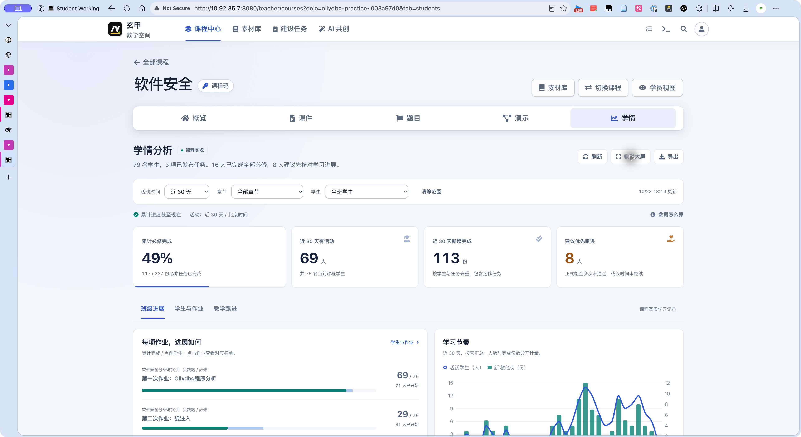
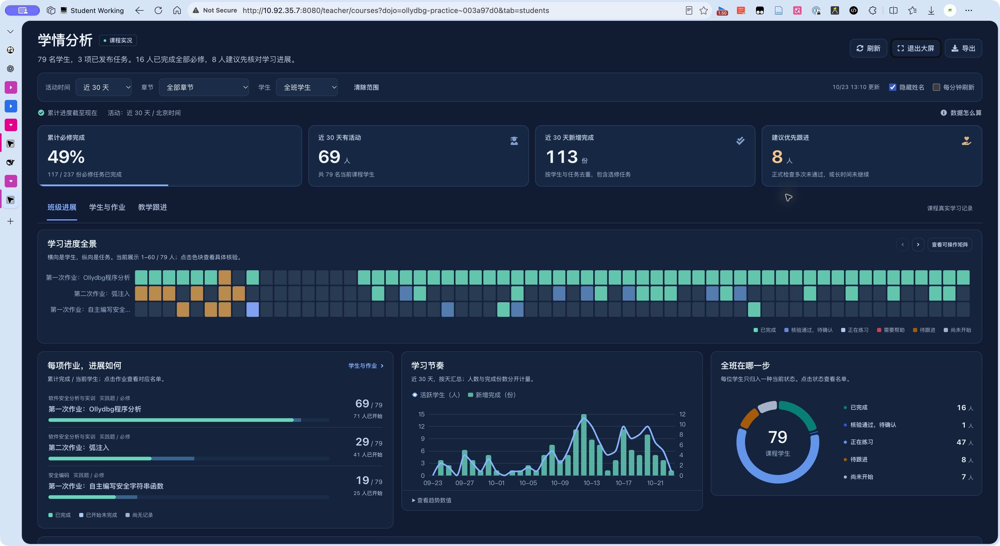

# 玄甲学情分析重构 · 研究与设计

日期：2026-10-23。范围：教师课程中心的学情功能、统计服务、证据下钻、跟进记录与大屏。保持课程中心其他工作流程。

## 现状审计

审计生产源码、现有教师账号的软件安全课程真实接口，并通过原生 Edge 浏览器实际检查旧版与新版。扩展接口一度不可用，后续以原生浏览器完成视觉、键盘与响应式验证。

技术：Flask / Flask-RESTX、SQLAlchemy、PostgreSQL、Jinja、原生 JavaScript、现有 ECharts 6.1.0。本功能原由 teacher-courses.js、learning-analytics.js、analytics.py 共同维护。教师权限通过 dojo_for_user(... teacher=True) 按课程校验。

旧接口审计快照：79 名课程成员，旧口径显示 72 人有期间活动、10 道题中 3 道必修、117 / 237 个必修学生题目组合完成。旧接口单次耗时约 0.57 秒。新版严格限定当前已发布任务，快照为 3 项任务、近 30 天 69 人有活动，累计仍为 117 / 237；不能把口径改变造成的活跃人数变化解释为学生退步。旧页面同时显示约 30.1% 的平均能力掌握与 91.6 分的平均评估成绩，两者对象与分母不同，容易被误读。

代码问题：

1. 时间窗口直接过滤 Solves，因而“完成率”随时间筛选丢失历史完成，不能代表累计进度。
2. analytics.py 同时做数据汇总、推断性风险加权、环境枚举及最多 25 个容器的实时探测；读分析页面可能触发环境同步。
3. 使用失败命令、重置次数、辅导次数加权支持需求；正常调试行为不能单独解释学习困难。
4. recentEvidence 是最多 8 类聚合摘要，不能直接看到一条正式核验的检查反馈。
5. 学生名单七列夹杂掌握度、充分度、风险等级，首屏四个分析页签，教学语言不足。
6. 新增流程探究式学习已有独立服务端核验表，但旧课程分析未接入这部分完成记录。
7. UI 与后端指标定义分别散落于多个大文件，旧静态测试甚至断言早已过时的版本号，不能保证统计准确。

## 成熟产品研究：观察 → 迁移

| 参考与一手资料 | 实际观察 | 玄甲采用 | 不照搬 |
|---|---|---|---|
| [Khan Academy Reimagined 教师报告](https://support.khanacademy.org/hc/en-us/articles/38554738905997-What-teacher-reports-are-available-on-Khan-Academy-Reimagined) | 官方工作页截图以学生×任务显示完成状态，支持进入具体作答；分开呈现进行中与完成未达目标 | 学生×实践任务矩阵、明确的文字状态、从色块打开具体证据 | 小学课程的掌握度等级不直接套到安全编码 |
| [Canvas 学生课程分析](https://community.instructure.com/en/kb/articles/660626-how-do-i-view-course-analytics-for-a-student-in-a-course) | 课程→学生分析，图表与表格可切换；明确数据刷新时间；页面访问记录有解释边界 | 快照时间、学生下钻、表格等价入口；浏览量不算掌握 | 24 小时刷新周期不适合本系统的即时编码核验 |
| [Moodle Analytics](https://docs.moodle.org/501/en/Analytics) | 明确区分描述、诊断和预测；日志本身只说明谁做了什么，不能自动说明学得多好 | 将观察事实与教学建议分开；删除首屏不可解释的综合风险分 | 未训练验证的预测模型不移植成学生标签 |
| [Grafana 大屏最佳实践](https://grafana.com/docs/grafana/latest/visualizations/dashboards/build-dashboards/best-practices/) | 文档与层级下钻示例强调相同对象比较、从概况进入细节、按数据流组织视图 | 大屏按累计完成→期间节奏→作业卡点组织；同一数据源，同一筛选范围 | 运维错误率、资源负载不等于教学指标 |
| [Metabase Dashboard interactivity](https://www.metabase.com/docs/latest/dashboards/interactive) | 点击图表可更新筛选或导航，筛选作用范围可见 | 章节、状态和题目点击联动到同一学生名单；显示并可撤销筛选 | 不向教师暴露 BI 查询编辑器 |
| [ECharts Dataset](https://echarts.apache.org/handbook/en/concepts/dataset/) / [VisualMap](https://echarts.apache.org/handbook/en/concepts/visual-map/) | 数据映射与表现分离；视觉编码可共享可解释尺度 | 前后端共享明确契约；完成、练习、待确认用固定配色 | 不用雷达面积制造不存在的六维能力结论 |
| [ECharts 无障碍](https://echarts.apache.org/handbook/en/best-practices/aria/) | ARIA 描述、纹理辅助颜色识别 | 图表文字总结、数据表格、键盘可点矩阵，尊重减少动态效果 | 不让 canvas 成为唯一的数据入口 |
| [DataV 开源大屏组件](https://github.com/DataV-Team/DataV) | SVG 装饰、数字与图表分区适合远距离展示 | 深色大屏、紧凑分区、学生×任务热力矩阵和图表反馈 | 不采用飞线、霓虹边框、自动滚动名单与无关地图，避免妨碍读数 |

研究不意味着复制品牌或直接引入整套依赖。实现沿用项目已有 ECharts，不增加外部 CDN，不上传学生数据到第三方。

## 设计方案与复核

教学场景：教师打开软件安全课程，首先需要知道三次作业各有多少人完成、谁的正式检查没有通过、打开哪条记录能核对原因，然后记录具体支持计划。

颜色：品牌蓝 #3158d4；正文墨色 #17233d；背景 #f3f6fc；通过青绿 #087f74；待处理琥珀 #a55a0a；失败红 #c14654。大屏底色 #101c34，文字 #edf3ff，强调蓝 #88b4ff。以同样语义映射深浅模式，不使用满屏渐变。

字体：系统中文字体 PingFang SC / Microsoft YaHei；普通文字 14–15 px、说明 12–13 px、标题 22 px；数字采用等宽数字。课程名、作业名支持换行与悬浮完整标题。

布局：

```
学情分析               时间 / 章节    刷新  大屏  导出
一行可读的班级结论 + 数据更新时间
累计完成 / 期间活跃 / 新增完成 / 需要帮助
班级进展      学生与作业      教学跟进
主要作业完成条形图       学习节奏趋势
需要帮助的学生           当前状态分布
点击作业 / 学生 → 侧面详情 → 正式检查项 / 评估 / 记录
```

自我复核：不采用一组相同大小的装饰卡片，不使用抽象雷达图；以“学生×真实作业”矩阵作为主要视觉与操作焦点。日常页面蓝白、信息明确；大屏是同一功能的展示模式，可隐藏姓名并定时刷新，不另造样例数据。

## 新统计契约

- 当前课程非教师成员；管理员不作为学生。
- 当前已发布实践题及当前发布版流程探究项目；草稿、教师预览不计入。
- 累计完成与活动期间分开；期间只控制活跃、新增完成、趋势。
- 完成分母 = 学生数 × 当前必修任务数；无学生/无任务时比例为 null，不显示虚假的 0%。
- 正式编码检查通过但未有平台完成记录，显示“核验通过，待确认”。失败命令、环境重置、AI 辅导量不生成能力标签。
- 最近一次 FINAL 评估展示实际分数；未评分为未评分，不用 0 替代。
- 近 7/30 天按天，较长期间按周，全部历史较长时按 30 天聚合；时区统一为北京时间。
- 所有图表、名单、导出来自同一快照。证据分页按记录 ID 游标，必须校验课程、学生与任务归属。
- 分析 GET 只读，不启动或探测容器。数据来源清楚标注，正式页面没有演示数据。
- 跟进采用不可变审计事件；保存基线、约定复查时间和教师复查结论。不宣称同期改善是干预造成的。


### 源码层面的参考取舍

阅读了 DataV 的 [fullScreenContainer 实现](https://github.com/DataV-Team/DataV/blob/master/src/components/fullScreenContainer/src/main.vue)。它以物理屏幕宽高和整体 transform 缩放布置展示画布。玄甲仍要支持教师操作和手机访问，因此采用响应式网格、每个图表的 ResizeObserver、独立全屏视图，不把整页等比例缩到难以阅读。大屏进入时将分析区域移到 body 层，隔离背景的键盘焦点；退出或切换课程后恢复位置与焦点，解决原全局导航遮挡问题。

Khan、Canvas、Moodle、Grafana、Metabase 的借鉴依据是上表官方工作界面、截图与文档；没有声称读取其闭源实现。ECharts 使用现有本地依赖，未复制其他产品的品牌资源。

## 实现与数据流

```
当前课程成员 + 当前发布任务
    ↓
Solves / LearningAttempts / LearningEvidenceEvents
LearningAuditEvents 正式核验回执 / FINAL 评估
InquiryAttempts / InquiryEvents 当前发布版学习记录
    ↓ 仅查询，不启动或探测运行环境
insights.py 数据适配 → insights_contract.py 统一统计契约
    ↓
同一快照 → 班级图表 / 学生矩阵 / 大屏 / CSV
    ↓ 按课程、学生、任务三层校验
正式核验检查项 / 已确认评分 / 过程证据
    ↓ 教师主动记录
不可变跟进事件 → 全课程基线 → 约定复查 → 新快照与教师结论
```

| 文件 | 职责 |
|---|---|
| dojo_plugin/learning/insights_contract.py | 无数据库依赖的确定性汇总、去重、时区、状态、趋势与指标定义 |
| dojo_plugin/learning/insights.py | 数据查询、发布版本范围、证据、核验回执、跟进与复查 |
| dojo_plugin/api/v1/teaching.py | 课程教师鉴权、参数校验、REST API、同口径 CSV |
| dojo_theme/static/js/dojo/learning-insights.js | 新分析控制器、过滤、图表联动、矩阵、详情、大屏、表单 |
| dojo_theme/static/css/learning-insights.css | 独立蓝白视觉与深色大屏、密度、响应式、焦点、减少动态效果 |
| dojo_theme/templates/teacher_courses.html | 替换旧分析区域与旧抽屉；挂载新版组件 |
| dojo_theme/static/js/dojo/teacher-courses.js | 课程切换与新版控制器集成；移除旧学情渲染和事件处理 |

接口前缀：`/pwncollege_api/v1/teaching/insights/{course}`。

| 方法 / 后缀 | 用途 |
|---|---|
| GET / | `timeRange`、`moduleIndex`、`studentId`、`taskKey` 作用范围内的报告 |
| GET /evidence/{student} | 指定 taskKey 的真实证据，before 游标向前翻页 |
| GET /checks/{student}/{receipt} | 正式核验的 failed / all 检查项、offset 分页 |
| POST /followups | 保存目标、复查时间、幂等 requestKey 和累计基线 |
| POST /followups/{identity}/review | 保存复查结论、依据、新快照；重复请求不覆盖原结论 |
| GET /export | 同一课程与范围的 UTF-8 BOM CSV，防电子表格公式注入 |

新的统计 GET 返回 `private, no-store`。学生或其他课程的教师不能读取本课程名单和回执。证据不暴露 Flag、学生源码或原始敏感回执。代码摘要用于定位提交，不宣称在浏览页面时重新执行代码或验证整个证据链。

查询只投影统计所需字段，正式回执不把完整检查列表放进报告。矩阵采用稀疏单元格，未观察到的格子表示“尚未开始”；前端和导出都实现这一约定，避免空班级或大班级产生大量重复数据。详情最近 10 次回执、最近 20 条已确认评估有明确范围；最新评估默认展示，更早评估折叠保留；过程证据与单次回执的检查项均可继续分页。

原 `/teaching/progress` 及旧模块保留兼容历史调用方，教师课程中心已完全切换到新服务。这次未修改学生判题器、成绩规则或课程发布流程，没有数据库结构迁移。

## 教师使用说明

1. 打开课程中心，选择课程的“学情”。首行先读班级结论；四项事实分别是累计完成、所选期间有活动、新增完成、建议优先核对的学生数。
2. 选择活动时间、章节或学生。时间只改变期间活动，章节与学生会改变统计对象；上方范围始终可见，可一键清除。
3. 点击某项作业的进度条，进入对应学生名单。矩阵每页 20 人、每组 5 个任务；可以搜索姓名或 ID，按学习状态筛选。
4. 点击学生或任意任务色块，打开学习详情。先看具体任务状态，再核对正式检查、已确认评分及过程记录。正式检查默认优先显示未通过项，也可查看全部并逐页加载。
5. 需要支持时，点击“记录一次教学跟进”，写下一项小目标和老师提供的帮助，选择复查时间。系统只保存课程记录，不自动给学生发消息。
6. 在“教学跟进”查看待复查项目。复查时先核对新证据，再记录观察结果；必修任务或发布版本改变时，不直接把两次完成数量相减。
7. 点击“教学大屏”展示同一快照的学习全景、各作业进展、学习节奏与状态分布。默认隐藏姓名，可以选择每分钟刷新；色块与旁边的可操作矩阵都能进入证据。Esc 退出详情，再次 Esc 退出大屏。
8. 点击“数据怎么算”查看口径。点击“导出”获得当前分析范围的 CSV。导出是另一个明确标注时间的快照，不保证与几分钟前页面逐秒相同。

## 实际验证与上线

验证日期：2026-10-23。浏览器使用线上真实账号与数据，非静态设计稿。

| 检查 | 结果 |
|---|---|
| 统计单元测试 | 22 项通过，覆盖历史完成、空分母、重复记录、跨日重复完成、无成绩、零分、正式检查、时区、选修、探究任务和稀疏矩阵 |
| DOM 集成 | 通过：初始页面、矩阵翻页、证据抽屉、转义、隐私、刷新失败保留快照、并发筛选、跟进表单、大屏背景隔离及恢复；使用明确标注的合成测试数据 |
| 真实数据库 | 软件安全 79 名课程成员，3 项发布任务，累计 117 / 237；11 次 SQL，最终抽样计算 0.176 秒；单次样本不是并发压测结果 |
| 真实 HTTP | 页面和所有新资源 200；报告、证据分页、208 项正式检查分页、只看失败、CSV 与报告行对齐均通过 |
| 权限与边界 | 匿名与学生被拒；错误学生、其他任务、错误回执归属、无效时间范围被拒；报告不缓存、不启动环境 |
| 跟进写入 | 实际模型中验证创建、重复创建、复查、重复复查；测试事务最终回滚，确认没有留下测试记录 |
| 期间筛选 | 浏览器切换近 7 天：有活动 36 人、新增完成 36 份，累计仍为 117 / 237；安全编码章节为 19 / 79 |
| 桌面 | 班级概览 → 作业名单 → 正式核验 → 20 项加载到 50 项 → 失败筛选；大屏进出和 60 人分组均实际操作 |
| 768×1024 | 趋势图改为单列，键盘展开趋势等价表格，数值与图表一致 |
| 390×844 | 范围筛选分行、两列指标、名单入口、全宽证据抽屉、跟进表单与取消操作可用 |
| 视觉修复 | 修复大屏被旧导航遮挡、白色页签条、暗色说明对比不足；大屏主要图表在宽屏内紧凑排列 |

当前生产库没有已发布的 `learning-flow` 项目，因此探究任务计数由合成契约测试覆盖，未声称完成其生产数据全链路验收。报告以已保存的实践与探究记录为依据，不把课件停留时长、页面访问或零散命令推断成知识掌握率。尚无历史记录的学生不会凭空补分，也不会标记为能力不足。

浏览器控制台检查到旧 favicon 404 与已安装注释扩展的连接错误；未观察到新分析模块的运行异常。没有更改用户扩展和浏览器安全设置。

测试复现见 [学情测试说明](../test/README-insights.md)。正式代码部署前做 SHA-256 并发检查、逐文件备份与原子替换，随后优雅重载 Gunicorn。备份位于服务器外层容器 `/opt/pwn.college/workspace/analytics-release-*`；初始后端、初始前端与每次修复分别保留。回滚需按文件恢复对应首个备份，不能用整个旧目录覆盖后续其他人的修改。新模块无数据库迁移，跟进仍使用原审计表。

### 上线截图

日常蓝白概览：



教学大屏，默认隐藏姓名：



窄屏与证据截图保存于本次验收工作目录，包含真实学生标识，不作为通用示例数据提交到项目中。
