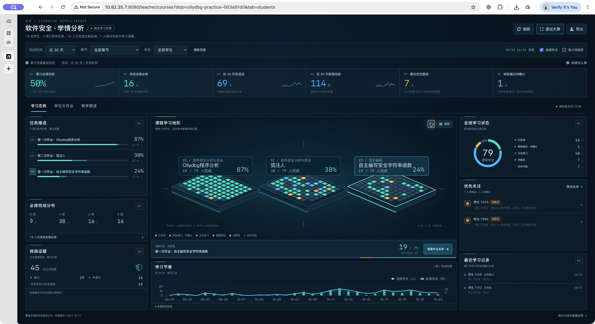

# 玄甲学情态势台：DataV 方向重构与验收

交付日期：2026-10-23。正式入口：课程中心 → 选择课程 → 学情；点击「教学大屏」进入集中展示。本文记录本轮实现，上一轮统计与权限设计见《学情分析重构-研究与设计》。

## 1. 对标方向与实际取舍

本轮以用户提供的四张 DataV 案例库截图及其中红框选中的案例为视觉目标。此前的双列报表卡片已替换为深色、三列、中央空间场景的教学态势台。

| 参考 | 具体观察 | 在玄甲中的落地 |
| --- | --- | --- |
| [阿里云 DataV 案例库](https://cn.aliyun.com/activity/intelligent/datav-showcase?from_alibabacloud=&version=2)：智能楼宇、智慧社区、项目汇报类 | 中心场景承载主体，周边短小面板解释进展与异常，细线框架形成秩序 | 中心是课程任务岛与学生状态格；左右为任务推进、完成分布、正式核验、关注名单和最近记录 |
| 同一案例库：云监控、电力、工业操控类 | 深色底、克制发光、窄边框、高密度数字与小图组合 | 石墨蓝底、青蓝进度、薄荷绿完成、琥珀色关注、紫色待确认；六项指标合并为连续指标带 |
| 同一案例库：城市交通、BaaS 与地图类 | 总览场景可以定位局部，局部数据与侧栏关联 | 点击作业定位任务岛；点击学生格进入该学生、该作业的核验证据；提供同数据矩阵入口 |
| [GoView 开源项目](https://github.com/dromara/go-view) | 图表与展示元素按组件组织 | 将空间渲染拆为 learning-atlas.js，控制器处理筛选、下钻和状态，统计仍由后端统一生成 |
| [ECharts 无障碍指南](https://echarts.apache.org/handbook/en/best-practices/aria/) | 可视化要同时提供可读信息 | 图表提供说明、趋势数值表；空间格提供键盘操作和完整证据入口 |

没有复制商业模板资源、地理地图或库存城市模型。课程没有学生地理分布或可靠的能力标签，因此中心场景表达真实的「课程 → 作业 → 学生状态」，不制造地理位置、知识掌握率、实时在线人数或实验运行状态。关联线表示同课程任务的空间组织，不表示前置依赖，也不表示正在传输的实时事件。

## 2. 统一设计与布局

- 背景 `#08131d`，面板 `#0c1c28`，分界 `#253b4d`。
- 主文字 `#e7f3fa`，次文字 `#b4c9d7`，辅助文字 `#91a9bb`。
- 完成 `#55e0c0`，正在练习 `#54b5f8`，待确认 `#b29cff`，需帮助 `#ff8293`，待跟进 `#edb867`。
- 中文使用系统字体，关键数字采用系统等宽字体；不新增远程字体依赖。
- 细线面板、4–5px 圆角、短标题、固定语义颜色；视觉重点集中在指标与学习地形。
- 普通课程页保留现有课程导航。分析打开时扩大可用宽度；离开分析后恢复原布局。
- 大屏在足够宽高的窗口中使用可伸缩三列。中央任务岛改为横向排列；小屏或矮窗口自然滚动。
- 平板先展示场景与趋势，再排列辅助面板。手机转为单列作业入口，去除缩小后难以点击的空间格和重复摘要。

## 3. 教师可完成的连续操作

1. 选择活动时间、章节或学生。累计完成始终截至快照时间，时间筛选仅影响期间活动和新增完成。
2. 从六项指标进入相应名单：全部、完成全部、期间活跃、期间新增完成、待跟进、核验通过待确认。
3. 点击左侧作业，在中心定位；中心摘要可进入这项作业的学生名单。
4. 空间格与矩阵中的每个入口都携带 studentId 和 taskKey。悬停可见姓名、作业与当前状态；大屏默认使用「学生 + 内部编号」替代真实姓名。
5. 每个任务岛只有一个初始格进入 Tab 序列。方向键移动、Home/End 到首尾、Enter/空格打开证据，避免数百次 Tab。
6. 证据抽屉展示实际正式检查、检查项、已确认评分和过程记录。正式检查通过与平台完成确认分开显示。检查列表支持失败筛选与分页。
7. 从证据上下文记录教学跟进，保存当前全课程必修进度作为基线，之后复查；提交去重、教师权限和不可覆盖的审计记录继续生效。
8. 大屏可隐藏姓名、暂停动效、选择每分钟刷新。自动刷新默认关闭；后台标签页或打开证据时不自动打断阅读。Esc 先关详情，再退出大屏。

## 4. 后端与组件实现

### 统一数据投影

`dojo_plugin/learning/insights_contract.py` 升级至 `2026-10-23.insights.v2`，在已有 report 中增加 atlas：

- `taskStates`：每项当前发布任务的状态计数，和必须等于当前范围学生数。
- `modules`：章节与任务映射，以及已完成学生任务组合数量。
- `completionBands`：按每位学生已完成的必修任务数分组。
- `checks`：正式回执次数、通过、失败、结果未记录、涉及的学生任务组合、最近正式核验通过的组合。
- `scoreBands`：仅采用已有实际评分；零分仍是有效评分，没有评分不补零。
- `recent`：最多 12 个学生任务组合的最近活动快照，不伪装为完整事件流。

通过次数只累计明确为 True 的正式检查；未知结果单列，不按通过处理。所有投影直接来自同一份已经去重、校验课程成员和任务范围的记录，不增加实验容器探测或数据库迁移。

### 前端边界

- `learning-atlas.js`：纯数据投影兼容层、原生 SVG 等距场景、语义色、指标微趋势；场景每页最多 3 项任务 × 80 位学生，可分页，顺序按内部 ID 稳定排列。
- `learning-insights.js`：报告加载、竞态控制、范围筛选、场景定位、矩阵、证据、跟进、隐私与大屏生命周期。
- `learning-insights.css`：仅作用于学情组件及分析打开时的课程容器宽度。处理焦点、窄屏、低动效设置和整屏密度。
- 图表复用站内 ECharts 6.1.0 的 SVG 渲染；每个图表独立监听尺寸并在销毁时解除监听。
- SVG 场景无需 WebGL、新增大型依赖或外部资源服务。标签与提示转义，状态不是任意 HTML。

已有教师鉴权、私有无缓存响应、任务/成员范围校验、证据分页、CSV 安全转义等继续沿用；旧统计接口保留兼容，新的教师页面使用统一 insights 接口。

## 5. 验证记录

### 自动化

- 27 项统计合同测试通过：时间窗口、空分母、去重、未来记录、未知成员、正式检查、零分、跨日首次完成、稀疏矩阵等。
- 新增 atlas 检查：每项任务的状态总数、完成分组、未知核验不算通过、最近活动不篡改完成日期、缺失评分不补零。
- DOM 场景通过：学生格与身份/作业映射、键盘开详情、作业定位、暂停动效、矩阵分页、转义、弹窗、大屏隐私/背景 inert/退出恢复、失败保留快照、并发筛选、跟进表单。
- 500 人 × 10 项任务的场景测试通过：每页最多 240 个格；末页学生与任务身份正确；标签中的 HTML 不执行。
- 真实数据库集成通过：约 11 次 SQL、单次检查约 0.23 秒（当次观测，非性能基准）。匿名和学生不能读取教师分析；其他学生/任务范围被拒绝；跟进创建/复查幂等测试全部回滚。
- 正式 HTTP 验证通过：新资源 200、私有 no-store、累计进度跨活动范围一致、场景计数与报告一致、核验/证据分页、CSV 与名单一致、无效范围拒绝。

### 浏览器实际操作

- 使用授权教师账号登录生产系统；在独立 Chrome 会话验收，避免和用户正在使用的 Edge 实验窗口冲突。
- 桌面普通课程页、教学大屏、任务定位、待确认名单、实际编码核验抽屉已检查。
- 实际待确认学生存在两次正式回执，每次 208 项检查；浏览器点击「加载更多」从 20 项扩展至 50 项。
- 教学跟进表单接续对应学生与任务正常，未向真实学生写入测试计划。
- 390 × 844 手机、768 × 1024 平板通过完整浏览器截图逐段检查；手机作业按钮进入对应任务名单，修复单列最近记录面板未撑满的问题。
- 控制台未观察到学情 JavaScript 异常；浏览器曾提示全站图标字体慢网络回退，未造成组件功能失败。
- 学生正在实际使用系统，期间完成数量和待跟进人数发生正常变化。截图与 HTTP 检查是各自时间点快照，数字不应固化为示例常量。

### 截图

下图为生产系统实际大屏截图，姓名隐藏。完整手机/平板截图及测试日志保留在本轮本地工作目录中，含真实学生信息的文件不放入公开说明资源。

## 6. 发布与回退

前端资源版本 `atlas-20261023-5`，部署使用内容哈希检查与逐文件备份，不覆盖并发变化。后端仅做纯报告投影升级，无数据库迁移。Gunicorn 使用经确认的主进程平滑重载；本轮发现容器重启后主进程号发生变化，部署工具已改为识别唯一 Gunicorn 主进程，不继续依赖固定 PID。

初始变更备份：`/opt/pwn.college/workspace/analytics-release-20261023T075657/`；后续迭代分别保留备份。需要回退时应按本轮文件列表恢复初始备份，删除本轮新增的独立 learning-atlas.js，恢复原模板引用，平滑重载。不要恢复整个仓库或覆盖其他任务的修改。本地 baseline.tar.gz 为本轮开始前的精确文件快照。

## 7. 当前边界

- 只分析已接入、已发布、教师有权管理的学习任务；没有把课件浏览或打开环境当作完成。
- 生产库此次未找到已发布的流程探究项目；该适配逻辑与合成测试保留，不能据此声称完成了真实生产项目数据验收。
- 不推测知识点掌握、学生能力或在机在线状态。未来接入可靠能力标签时，再增加能力网络，不能用命令数或点击量替代。
- 矩阵在窄屏保留横向滚动和学生姓名列固定；空间场景的大班级/多任务通过分页控制密度。
